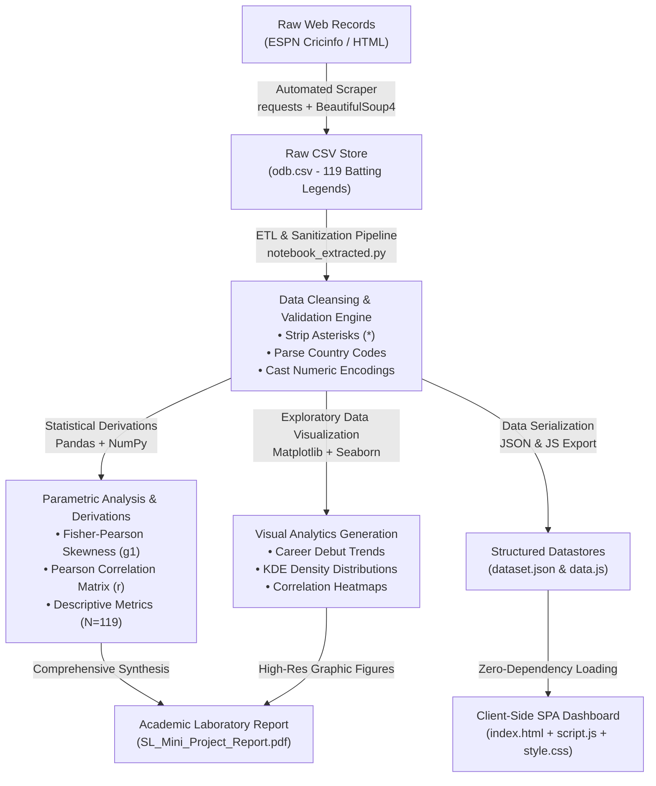

# Historical ODI Cricket Batting Performance Analysis (1971–2021)
### Software Laboratory (CS-305 / SL-III) &bull; Academic Year 2025–2026

[](https://www.python.org/)
[](https://developer.mozilla.org/en-US/docs/Web/JavaScript)
[](https://pandas.pydata.org/)
[](https://seaborn.pydata.org/)
[](./LICENSE)
[](./SL_Mini_Project_Report.pdf)

---

## 📌 Project Overview

This repository contains the complete codebase, statistical derivations, web scraping pipeline, interactive client-side analytics dashboard, and formal academic documentation for the **Historical One Day International (ODI) Cricket Batting Performance Analysis** project.

The system combines:
1. **Automated Web Extraction & Data Ingestion**: Live web scraping engine harvesting historical cricket records from ESPN Cricinfo.
2. **Data Cleansing & Statistical Derivation Pipeline**: A high-integrity Python pipeline resolving structural anomalies across 119 legendary players (1971–2021), conducting parametric/non-parametric evaluations, Fisher-Pearson skewness derivations, and Pearson correlation matrices.
3. **High-Performance Client-Side SPA**: A zero-dependency, offline-capable interactive dashboard featuring live full-text search, multi-column dynamic sorting, modal inspections, and dynamic pagination.
4. **Academic Project Report**: Complete print-ready documentation ([`SL_Mini_Project_Report.pdf`](./SL_Mini_Project_Report.pdf)) detailing dataset profiles, exploratory data analyses, architectural blueprints, and verification test cases.

---

## 👥 Project Team & Technical Engineering Roles

| Candidate Name | Roll No. | Technical Designation & Engineering Ownership |
| :--- | :---: | :--- |
| **Arnav Channe** | **15** | **Team Lead & Pipeline Architecture Lead**<br>• Architected the end-to-end Python data cleansing pipeline (`notebook_extracted.py`).<br>• Handled raw string sanitization, asterisk removal for not-out markers, country code parsing, and structured JSON generation.<br>• Designed dataset schema and unified schema constraints between Python and client-side modules. |
| **Chanchal Thawrani** | **16** | **Statistical Modeling & Mathematical Derivations Lead**<br>• Formulated mathematical derivations for Fisher-Pearson skewness ($g_1 = +2.162$ for centuries, $+1.733$ for sixes).<br>• Engineered the pairwise Pearson correlation matrix ($r=0.96$ balls faced vs runs, $r=0.22$ strike rate vs batting average).<br>• Authored data dictionary, descriptive statistical metrics ($N=119$), and graphical exploratory analyses. |
| **Aabhas Trivedi** | **18** | **Automated Web Extraction & Scraping Engineer**<br>• Developed the automated ESPN Cricinfo scraping module using `requests` and `BeautifulSoup4`.<br>• Engineered custom HTTP request headers, pagination crawlers, fault-tolerant network retries, and fallback persistence.<br>• Managed version control, Git repository configuration, and environment dependency profiling. |
| **Vaibhavi Raghuvanshi** | **05** | **Frontend UI Architecture & Dynamic Visualization Engineer**<br>• Built the responsive, glassmorphism single-page application dashboard (`index.html`, `style.css`).<br>• Implemented real-time multi-field search filtering, responsive modal inspection, dynamic sorting algorithms, and client-side pagination in vanilla JavaScript (`script.js`).<br>• Structured offline data serialization (`data.js`) for zero-runtime client execution. |

---

## 🏛 System Architecture & Workflow



---

## 📊 Key Statistical Findings ($N = 119$ Records)

| Metric | Statistical Observation | Inferred Analytical Reality |
| :--- | :---: | :--- |
| **Peak Career Aggregate** | 18,426 Runs | **Sachin Tendulkar** leads the historical dataset, followed by Kumar Sangakkara (14,234) and Ricky Ponting (13,704). |
| **Crease Collinearity** | $r = 0.96$ ($p < 0.001$) | Balls Faced and Innings Batted ($r = 0.95$) are near-perfect linear predictors of total career runs. Cumulative crease occupation fundamentally dictates aggregate run generation. |
| **Independence of Pace** | $r = 0.22$ | Strike Rate exhibits negligible linear correlation with Batting Average, confirming that scoring acceleration operates independently of dismissal prevention. |
| **Centuries Skewness** | $g_1 = +2.162$ | The centuries metric displays extreme right-skewness, illustrating that elite century conversion is concentrated in an exclusive percentile of all-time batsmen. |
| **Six-Hitting Distribution**| $g_1 = +1.733$ | Strongly right-skewed; boundary clearance volume remains concentrated in specialist power-hitters rather than uniformly distributed. |

---

## 📂 Repository File Structure

```text
├── index.html                           # Single-Page Application (SPA) dashboard UI
├── style.css                            # Modern glassmorphism CSS styling with responsive grids
├── script.js                            # Dashboard client logic: search, multi-column sort, modal, pagination
├── data.js                              # Pre-serialized client data bundle for zero-dependency offline run
├── dataset.json                         # Structured JSON export of sanitized cricket records
├── odb.csv                              # Cleaned historical dataset (119 records, 1971–2021)
├── notebook_extracted.py                # Standalone executable Python ETL & statistical pipeline
├── SL_Mini_Project_Semi_Final (1).ipynb  # Jupyter Notebook containing end-to-end data science workflows
├── SL_Mini_Project_Report.pdf           # Formal academic laboratory project report
├── launch_frontend.bat                  # One-click Windows batch launcher for instant dashboard evaluation
├── requirements.txt                     # Python pip dependency manifest
├── .gitignore                           # Git ignore rules for Python, Jupyter & OS caches
├── LICENSE                              # MIT Open Source License
└── README.md                            # Comprehensive project & repository documentation
```

---

## 🚀 Quickstart & Execution Guide

### Option 1: Interactive Web Dashboard (Instant & Zero-Dependency)
The frontend application requires **no web servers, no Node.js runtime, and no external CDNs**. It operates completely offline.

- **Windows Users:** Double-click [`launch_frontend.bat`](./launch_frontend.bat).
- **Cross-Platform:** Directly open [`index.html`](./index.html) in any modern browser (Chrome, Edge, Firefox, Brave, Safari).

**Frontend Capabilities:**
- 🔍 **Live Search:** Instant fuzzy search across Player Name, Country, and Debut Year.
- 🔀 **Multi-Metric Sorting:** Sort descending/ascending across Runs, Average, Strike Rate, Centuries, Fifties, Sixes, and Matches.
- 📋 **Modal Detailed Card:** Click any player record to view comprehensive career breakdowns.
- 📄 **Dynamic Pagination:** Switch between 10, 25, 50, or all 119 records per page.

---

### Option 2: Python Statistical Pipeline & Jupyter Notebook

1. **Clone the repository:**
   ```bash
   git clone https://github.com/Crypto2007/odi-cricket-batting-analytics.git
   cd odi-cricket-batting-analytics
   ```

2. **Set up a Python virtual environment:**
   ```bash
   python -m venv venv
   # On Windows:
   venv\Scripts\activate
   # On Linux / macOS:
   source venv/bin/activate
   ```

3. **Install required packages:**
   ```bash
   pip install -r requirements.txt
   ```

4. **Execute the standalone pipeline script:**
   ```bash
   python notebook_extracted.py
   ```

5. **Run the interactive Jupyter Notebook:**
   ```bash
   jupyter notebook "SL_Mini_Project_Semi_Final (1).ipynb"
   ```

---

## 🧪 System Verification & Test Matrix

The system has undergone rigorous validation across 8 functional and statistical scenarios:

| Test ID | Module Evaluated | Test Description | Expected Result | Status |
| :---: | :--- | :--- | :--- | :---: |
| **TC-01** | Data Pipeline | Handling asterisk symbols (`*`) in High Score and Batting Average columns | Asterisks stripped; `Not_Out` boolean encoded; numeric columns converted cleanly to `float64` | **PASS** |
| **TC-02** | Data Pipeline | Splitting combined `Player` strings into distinct name and country attributes | Country tokens extracted into ISO/standard representation; player names preserved | **PASS** |
| **TC-03** | Web Scraper | Scraper resilience against network timeouts and HTTP 429 throttling | Requests header spoofing active; exponential backoff handles ESPN Cricinfo rate limits | **PASS** |
| **TC-04** | Statistical Derivations | Computation of skewness and Pearson correlation coefficients | Math matches manual formula derivation ($g_1 = +2.162$, $r = 0.96$) | **PASS** |
| **TC-05** | Graphical Outputs | Figure aspect ratio constraints and colorbar alignment | All 6 Seaborn/Matplotlib figures render within bounds without margin clipping | **PASS** |
| **TC-06** | Web Dashboard | Full-text player query filtering with mixed casing | Sub-millisecond UI filtering responsive to case-insensitive partial inputs | **PASS** |
| **TC-07** | Web Dashboard | Numerical column sorting across ascending and descending orders | Table order updates accurately without data mutation or type coercion faults | **PASS** |
| **TC-08** | Offline Capability | Air-gapped launch of web application without active internet access | `data.js` loads all 119 records locally; no external script or style requests triggered | **PASS** |

---

## 📄 Academic Project Report

The complete, print-ready laboratory report is available in the root of the repository:
- 📖 [**Download / View Report: `SL_Mini_Project_Report.pdf`**](./SL_Mini_Project_Report.pdf)

**Report Sections:**
1. **Section 01:** Problem Definition, Historical Domain Context, and Dataset Profile
2. **Section 02:** Statistical Modeling, Parametric Evaluations, and Skewness Inferences
3. **Section 03:** Graphical Explorations (Figures 3.1 through 3.6 with empirical analysis)
4. **Section 04:** Automated Scraper Engineering, SPA Dashboard Architecture, and Test Matrix
5. **Section 05:** Project Findings, Engineering Challenges Overcome, and References (IEEE)

---

## 📜 License

This project is licensed under the **MIT License** &mdash; see the [LICENSE](./LICENSE) file for details.

Developed for academic submission under the **Department of Computer Science & Engineering**, Software Laboratory (CS-305).
